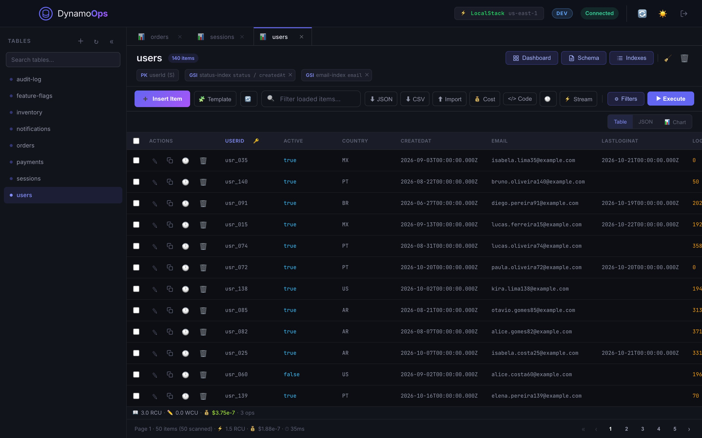
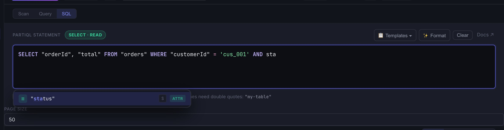
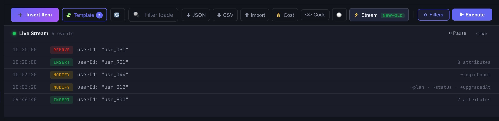
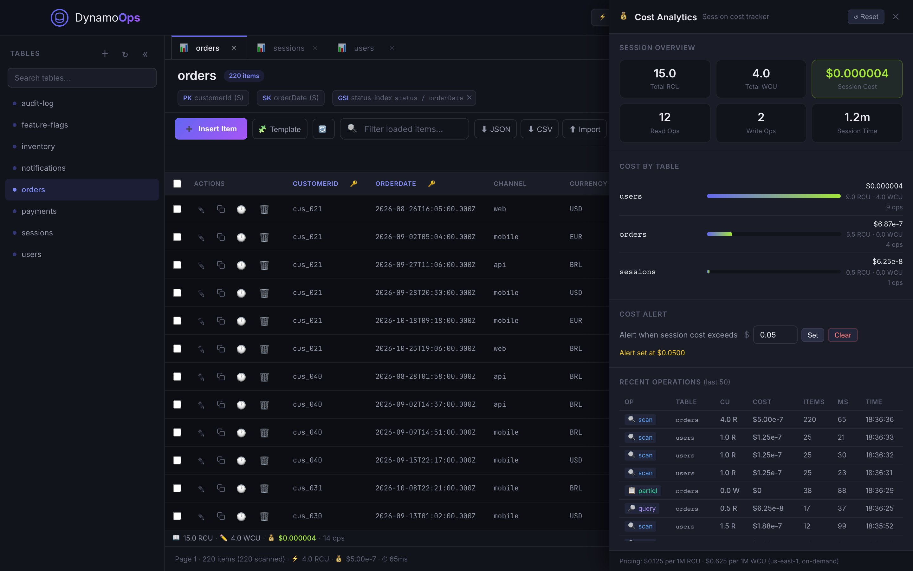
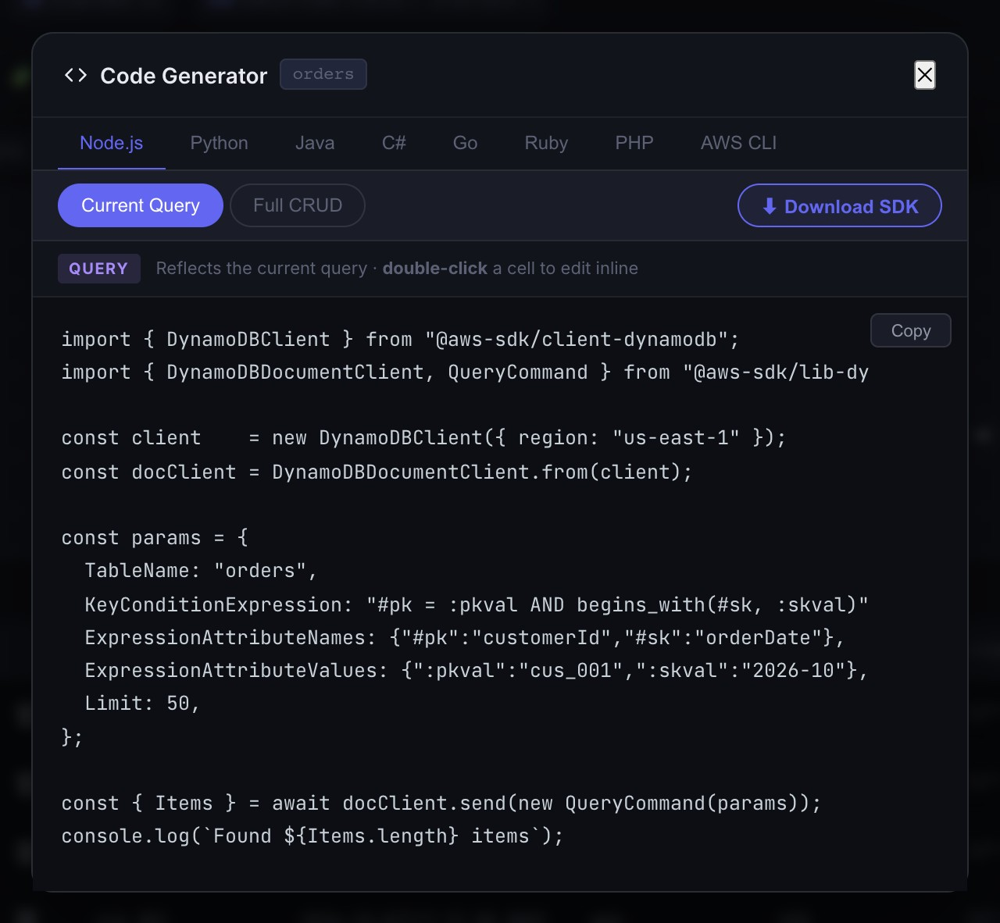

<p align="center">
  
</p>

<h1 align="center">DynamoOps</h1>

<p align="center">
  <strong>A free, fast desktop app for Amazon DynamoDB.</strong><br/>
  Query, edit and manage your tables without fighting the AWS Console. macOS and Windows.
</p>

<p align="center">
  <a href="https://github.com/renatoasterio/DynamoOps/releases/latest"></a>
  
  <a href="LICENSE"></a>
  <a href="https://dynamoops.io/docs"></a>
</p>

<p align="center">
  <a href="https://github.com/renatoasterio/DynamoOps/releases/latest"><b>Download</b></a> ·
  <a href="https://dynamoops.io/docs"><b>Documentation</b></a> ·
  <a href="#build-from-source"><b>Build from source</b></a> ·
  <a href="README.pt-BR.md">Leia em português</a>
</p>

<p align="center">
  
</p>

---

## Why DynamoOps

The AWS Console reloads on every click, and the CLI makes you memorize syntax. DynamoOps puts everything you do with DynamoDB in one fast desktop window.

- **Every feature is free.** There are no plans, no trials, no account and no license key.
- **It runs on your machine.** Credentials and table data never leave it, and there is no telemetry.
- **It works at work too.** Companies, including for-profit ones, can use it internally.

## Download

Get the latest installers from the **[releases page](https://github.com/renatoasterio/DynamoOps/releases/latest)**.

| System | File |
|---|---|
| macOS · Apple Silicon (M1 or newer) | `DynamoOps-<version>-arm64.dmg` |
| macOS · Intel | `DynamoOps-<version>-x64.dmg` |
| Windows 10/11 · installer | `DynamoOps-Setup-<version>.exe` |
| Windows 10/11 · portable, no install | `DynamoOps-<version>-portable.exe` |

Every release includes `SHA256SUMS.txt` so you can verify the files you downloaded.

> [!NOTE]
> The builds are not signed with Apple or Microsoft certificates yet.
> - **macOS:** on first launch, macOS says it cannot verify the app. Click **Done**, open **System Settings › Privacy & Security**, click **Open Anyway** next to the DynamoOps message and confirm. You only do this once per version.
> - **Windows:** if SmartScreen warns you, click **More info** and then **Run anyway**.

## Features

<table>
<tr>
<td width="50%">

**Connect to anything**
AWS CLI profiles, saved profiles with recent connections, Assume Role with role history, AWS SSO (IAM Identity Center) sign-in in the browser, and custom endpoints for DynamoDB Local and LocalStack. Each connection can carry an environment tag (dev, qa, staging, prod, local).

**Query without the docs open**
Scan with filter expressions, Query by key on the table or any GSI/LSI, and a PartiQL editor with syntax highlighting, context-aware autocomplete, templates built from your schema, formatting and a confirmation before writes.

**Edit data in place**
Double-click a cell to edit it, or open the full JSON editor. Insert, clone and bulk delete items, use per-table insert templates, and restore any previous version from the item history with a field-by-field diff.

</td>
<td width="50%">

**See what every operation costs**
The read and write capacity DynamoDB reports for each operation, a running session total per table and a cost alert.

**Watch changes live**
A real-time DynamoDB Streams feed with INSERT, MODIFY and REMOVE events and attribute-level change summaries.

**Ship infrastructure and code**
Export a table as CloudFormation, Terraform or Pulumi. Generate a snippet for the current query, or a complete data-access project (entities, repositories, services) in TypeScript, Python, Java, C#, Go, Ruby, PHP or AWS CLI scripts.

**And the rest**
Multiple tables in tabs, table/JSON/chart views with a partition heatmap, JSON/CSV/Excel import, JSON/CSV export, a table dashboard with CloudWatch metrics, keyboard shortcuts, a collapsible sidebar, and dark and light themes.

</td>
</tr>
</table>

<p align="center">
  
  
</p>
<p align="center">
  
  
</p>

## Documentation

The full guide, feature by feature with screenshots, lives at **[dynamoops.io/docs](https://dynamoops.io/docs)**. It is also available in [Portuguese](https://dynamoops.io/pt/docs) and [Spanish](https://dynamoops.io/es/docs).

Good places to start:

- [Quick start](https://dynamoops.io/docs/getting-started/quick-start)
- [Connecting to DynamoDB](https://dynamoops.io/docs/connections/connecting)
- [Keyboard shortcuts](https://dynamoops.io/docs/workspace/keyboard-shortcuts)
- [Security and privacy](https://dynamoops.io/docs/reference/security-and-privacy)

## Keyboard shortcuts

`Cmd` on macOS, `Ctrl` on Windows.

| Shortcut | Action |
|---|---|
| `Cmd+Enter` | Run the current Scan, Query or SQL |
| `Cmd+R` | Refresh the current query |
| `Cmd+W` | Close the active tab |
| `Cmd+[` / `Cmd+]` | Previous / next tab |
| `Cmd+K` | Search tables in the sidebar |
| `Cmd+B` | Collapse or expand the sidebar |
| `Cmd+F` | Filter the loaded items |
| `Esc` | Close the open dialog |

## Build from source

You need **Node.js 18+**, npm and Git.

```bash
git clone https://github.com/renatoasterio/DynamoOps.git
cd DynamoOps
npm install

npm run electron   # desktop app
npm run dev        # browser only, at http://localhost:3457
```

Tests and lint must pass before a pull request is merged:

```bash
npm test
npm run lint
```

Build installers locally (output in `dist/`):

```bash
npm run build:prod:mac            # macOS Apple Silicon (.dmg)
npm run build:prod:mac:universal  # macOS Universal
npm run build:prod:win            # Windows x64 (installer + portable)
```

> [!TIP]
> Building the Windows installer on an Apple Silicon Mac needs Rosetta, because electron-builder's Windows tools are Intel binaries. The release workflow builds both platforms on native GitHub runners, so you rarely need this.

### Releases

Releases are built by [`.github/workflows/release.yml`](.github/workflows/release.yml). `main` is protected, so the version bump goes through a pull request and the tag is pushed after the merge:

```bash
# 1. Bump the version in a pull request
git switch -c release/3.0.1
npm version 3.0.1 --no-git-tag-version
git commit -am "chore(release): 3.0.1"
git push -u origin release/3.0.1      # open the PR, review and merge it

# 2. Tag the merged commit on main
git switch main && git pull
git tag v3.0.1
git push origin v3.0.1
```

Pushing the tag starts the workflow. It runs tests and lint, builds the macOS DMGs and the Windows installer and portable exe, and publishes them with checksums as a GitHub release.

## Architecture

Electron with a local Express server on `127.0.0.1:3457` and a plain JavaScript (ES modules) frontend, with no framework.

```
electron-main.js            Electron main process: starts the server, opens a sandboxed window
server.js                   Express entry point (browser mode)
src/backend/
  config/                   Server host/port and AWS clients per connection
  middleware/               Local-only API (Host/Origin), security headers, errors, validation
  controllers/, services/   DynamoDB, STS, SSO and Streams
  routes/api.js             /api routes
public/
  index.html, styles.css    The single-page app and its themes
  js/components/            UI components (DataViewer, QueryPanel, SqlEditor, TabManager, …)
  js/codegen/               Code generators, one module per language
  js/utils/, js/state/      Helpers and app state
scripts/build-prod.js       Production build (esbuild + electron-builder)
tests/                      Jest test suites
```

### Security

- The local API acts with your AWS credentials, so it listens only on `127.0.0.1` and rejects requests whose `Host` or `Origin` is not the app. This protects against DNS rebinding and against websites in your browser calling it.
- Data read from DynamoDB is treated as untrusted. Everything rendered as HTML is escaped, and a strict Content Security Policy blocks inline scripts.
- The Electron window is sandboxed, has no Node.js access, cannot navigate away from the app and only opens `https:` links in your browser.

Found a vulnerability? See [SECURITY.md](SECURITY.md).

## Contributing

Issues and pull requests are welcome. Read [CONTRIBUTING.md](CONTRIBUTING.md) for the workflow and the code conventions.

## License

DynamoOps is released under the **[MIT License with the Commons Clause](LICENSE)**, plus one extra condition against embedding it in paid products.

- ✅ Anyone, including companies, can use it for free, also at work.
- ✅ You can copy, modify and redistribute it, keeping the `LICENSE` file and the copyright notice.
- ❌ You cannot sell DynamoOps or charge for a product or service based on it, including paid hosting, consulting or support.
- ❌ You cannot embed DynamoOps, in whole or in part, in a paid product or service.

Because of these restrictions the license is *source-available* rather than open source as defined by the [OSI](https://opensource.org/osd).

Copyright © 2026 Renato Asterio.
